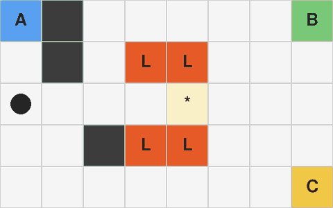

# How do computers learn to play games?

Hands-on files for the reinforcement learning workshop with the University of Birmingham AI Society (24 November 2026).

You'll train an AI agent to solve the grid game from the talk. Then you'll steer it, and break it, by changing only its rewards. You only edit a few numbers. No machine learning background needed.

<p align="center">
  
</p>

**Slides:** [`docs/slides.pdf`](docs/slides.pdf). Faded slides marked "hidden" weren't shown in the talk, but they include the warm-up answers.

## 1. Get the files

Click the green **Code** button above, then **Download ZIP**, and unzip it. Or:

```bash
git clone https://github.com/ajuanijustus/intro-rl-workshop.git
```

**Already set up an `rl-handson` folder from the setup guide?** Copy all the `.py` files into it, activate your environment, and skip to step 3.

## 2. Set up (about 10 minutes, before the session if you can)

Open a terminal in the folder with these files, then:

```bash
python -m venv .venv
source .venv/bin/activate        # Windows: .venv\Scripts\activate
python -m pip install --upgrade pip
python -m pip install -r requirements.txt
python smoke_test.py             # a grid window flashes up, then: ALL GOOD
```

- **macOS:** if `python` isn't found, use `python3` for the commands before activating. After activating, `python` works.
- **Windows:** if `python` opens the Microsoft Store, use `py -3.12 -m venv .venv` instead. You need Python 3.10 or newer (3.11 or 3.12 recommended).
- **WSL or no window:** the smoke test says `ALL GOOD (without a window)`. That's fine. Set `WATCH = False` in the scripts.
- Tested with Python 3.12, Gymnasium 1.4 and NumPy 2.5 on macOS.

More detail, including installing Python, is in the one-page [setup guide](docs/rl_handson_setup_guide.pdf).

Remember to activate your environment every time you open a new terminal.

## 3. Warm-up: `q_learn.py`

```bash
python q_learn.py
```

The agent practises Cliff Walker for 500 games, prints its plan as arrows, then does a **TEST RUN** with no random moves. Watch it walk in the window.

Now change **one** setting at a time in the `TWEAK THESE` block at the top. **Write down what you predict first**, then run it and read the TEST RUN line:

| Change this | What do you predict? | What happened? (TEST RUN line) |
|---|---|---|
| `EPSILON = 0` | | |
| `EPSILON = 1` | | |
| `GAMMA = 0` | | |
| `ALPHA = 0.01` | | |
| `EPISODES = 20` | | |

Set each one back before trying the next.

This table is also a one-page printable worksheet: [`docs/warmup_worksheet.pdf`](docs/warmup_worksheet.pdf) (A4). Running this workshop yourself? Print one per student or pair as a handout.

## 4. Reward-design missions: `missions.py`

You can't touch the learning algorithm. You can only change what the agent is **rewarded** for.

1. Open `missions.py` and set `MISSION = 1`.
2. Run `python missions.py` and read the brief.
3. Put your changes in `CHANGES`, for example `CHANGES = {"B": 2.0}`, and run it again.

Three agents train each time, and the mission only counts if **all three** succeed. If you fail, it prints a hint. Missions 1 to 6 get harder. Mission 6 has a twist.

`gridlab.py` must be in the same folder as `missions.py`. You don't need to edit it.

## Finished early?

- Beat each mission with the **smallest** change you can find.
- In `q_learn.py`, try `ENV = "FrozenLake"` with `ENV_KWARGS = {"desc": MY_MAP, "is_slippery": True}`. Design your own map in `MY_MAP`. How many games does slippery ice need?
- Change one line in `q_learn.py` so the Bellman target uses the move the agent will *actually* take next, not the best move. (That's an algorithm called SARSA.) Does it still hug the cliff edge?
- In `q_learn.py`, `STEP_BONUS` adds the same reward to every step. On FrozenLake, try `STEP_BONUS = -0.01` and then `-0.1`, with and without slippery ice. Predict first: does a cost per step make it hurry to the goal, or does it find a loophole?
- Deep RL: unit 1 of the [Hugging Face Deep RL course](https://huggingface.co/learn/deep-rl-course/en/unit1/hands-on), in its Colab notebook.

## Stuck, or after the session?

- [`docs/warmup_and_missions_explained.pdf`](docs/warmup_and_missions_explained.pdf) explains what happens in the warm-up and how to solve every mission, with hints before each answer, plus more to try at home (your own FrozenLake maps, slippery ice, a safer SARSA agent, Taxi). **Spoilers**, so give each mission a proper go first.
- `python bonus_reveal.py` shows why mission 6 can't be solved, and how one extra piece of memory fixes it.

## Common problems

| Problem | Fix |
|---|---|
| `ModuleNotFoundError: No module named 'gymnasium'` | Your environment isn't active. Run the `activate` line again |
| `ModuleNotFoundError: No module named 'gridlab'` | Run `missions.py` from the same folder as `gridlab.py` |
| `Couldn't open a window` / no window appears | Set `WATCH = False`. Everything still prints in the terminal |
| `'X' is locked in this mission` | That setting can't change in this mission. Remove it from `CHANGES` |
| PowerShell won't run `activate` | `Set-ExecutionPolicy -Scope CurrentUser RemoteSigned`, or use cmd |

## About

Made by [Aju Ani Justus](https://ajuanijustus.com), PhD student in Computer Science at the University of Birmingham, working on multi-agent reinforcement learning. Questions or ideas: [LinkedIn](https://linkedin.com/in/ajuanijustus).

Released under the [MIT licence](LICENSE).
